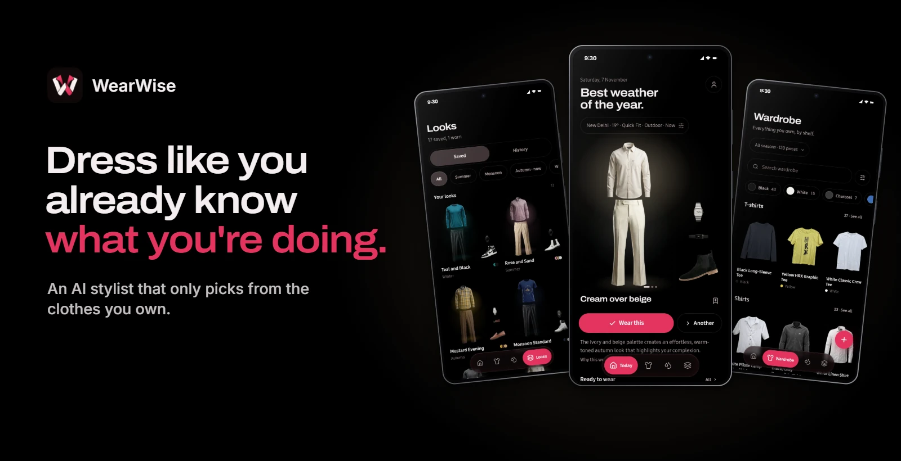
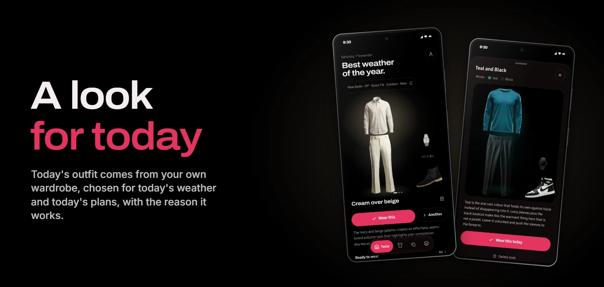
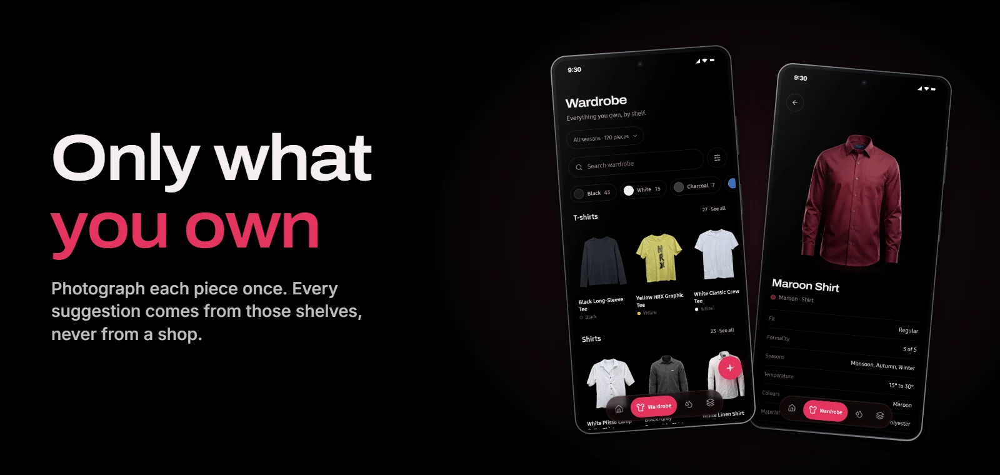
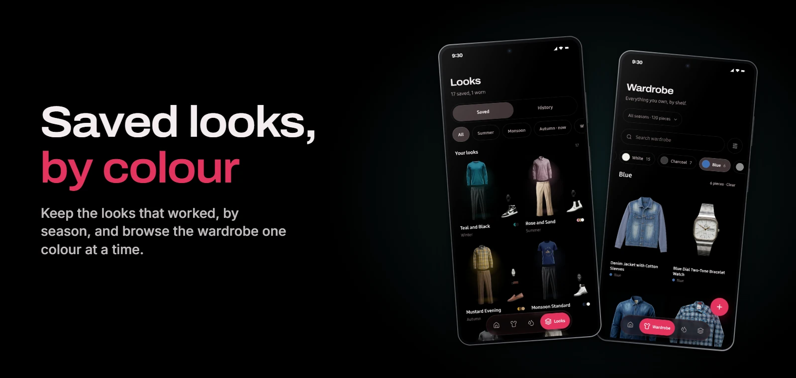
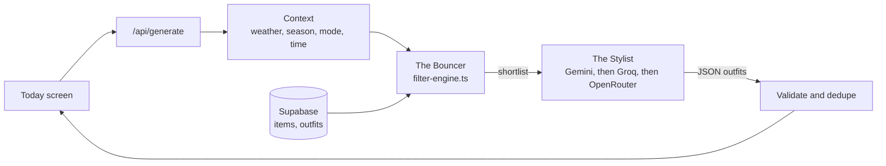

<p align="center">
  <picture>
    <source media="(max-width: 600px)" srcset="docs/readme/hero-mobile.webp">
    
  </picture>
</p>

<p align="center">
  <strong>An AI stylist that only picks from the clothes you actually own.</strong><br>
  Open it in the morning and it has already chosen today's outfit, for today's weather and today's plans.
</p>

<p align="center">
  <a href="https://getwearwise.vercel.app"></a>
  <a href="https://github.com/TheAlgo7/wearwise-go-by-algothrim"></a>
</p>

<p align="center">
  <a href="#what-it-looks-like">What it looks like</a> ·
  <a href="#features">Features</a> ·
  <a href="#how-it-works">How it works</a> ·
  <a href="#run-it-locally">Run it locally</a> ·
  <a href="#privacy-and-security">Privacy</a>
</p>

## Why WearWise

Most AI fashion apps are built for an average user who does not exist. WearWise was built for one real person standing in front of one real wardrobe at 7 AM, who needs an answer, not a mood board.

That constraint shapes everything. It only suggests clothes he owns. It knows the weather in Delhi right now, the season, where he is going and when. It carries his style rules: which fits work on him, which colours he wears, which belts are the favourites. The model is handed a short, relevant list, not a raw wardrobe dump, and asked to decide.

This repository is a public case study in software built around one life instead of a persona. The live app is PIN-locked, because it is somebody's actual wardrobe.


The live app is PIN-locked; [the public demo](https://getwearwise.vercel.app) runs the same stylist on a sample wardrobe, entirely on your device.

## What it looks like

<picture>
  <source media="(max-width: 600px)" srcset="docs/readme/today-mobile.webp">
  
</picture>

**A look for today.** Opening the app generates one outfit from the wardrobe, for the weather, the season and where you're going, with the reason it works.

<picture>
  <source media="(max-width: 600px)" srcset="docs/readme/wardrobe-mobile.webp">
  
</picture>

**Only what you own.** Every suggestion comes from the pieces you've photographed, by shelf, each lit by its own colours on a true-black screen.

<picture>
  <source media="(max-width: 600px)" srcset="docs/readme/looks-mobile.webp">
  
</picture>

**Saved looks, by colour.** Keep the combinations that worked, filtered by season, and browse the wardrobe one colour at a time.

## Features

- **Today decides for you.** Opening the app generates one outfit. Wear this, ask for another, or swipe between the options, with a light tick on Android when you do. The result is cached against its context, so reopening the app does not spend another model call.
- **One context line.** City, temperature, mode, indoor or outdoor, and when. Ten modes cover the week: Quick Fit, Home, Casual, Smart, Gym, Church, Travel, Impress, Night, or describe where you are going.
- **Four Indian seasons.** Summer, monsoon, autumn and winter, picked from live weather or set by hand. Winter unlocks the cold-weather layers; real heat keeps them out.
- **Lights down.** The screen is true black, so the clothes are the only colour on it. An outfit stands as a figure, shirt over trousers, shoes and accessories beside it, lit from behind by its most telling colour and named after it: "Burgundy over black". The garments themselves are never tinted.
- **Photo to closet.** Add a photo and the background is cleaned and the piece is tagged by AI: category, colour, formality, vibe and temperature range. If the first model is slow, two more take over inside the same request.
- **A partner view.** A second PIN gives read and suggest access: browse the wardrobe, build a look piece by piece and send it as a pick. Adding, editing and private screens stay with the owner.

<details>
<summary><strong>Everything else it does</strong></summary>

- **The wardrobe by shelf, or by colour.** T-shirts, shirts, bottoms, footwear and accessories as rails you can drill into, with search and a season filter. A row of every colour you own, with counts, opens everything in that colour in one tap.
- **Looks.** Save a combination you like, filter by season, and read why it works.
- **Care.** Morning and night routines and grooming dates, worked out by a plain rules engine with no model involved, and visible only to the owner. Hair care follows the hair, not the shower: a wash window you can tune, gentle and medicated shampoos kept apart, a settling period after chemical treatments, and nothing counted as done until you log it.

</details>

## How it works



- **The Bouncer runs in code.** Temperature, formality, vibe, season and recent wear filter the wardrobe before any model sees it. Belts and watches follow the outfit rather than the mode, so a casual day still gets the good watch. The shortlist is capped so the model sees a focused set, not 120 pieces.
- **The Stylist is the last mile.** The prompt carries the shortlist, the context and a style blueprint with hard rules that always ship. The model returns outfits as JSON, with a short note about the clothes.
- **Nothing the model says is trusted blindly.** Every returned id must exist in the shortlist. Layers are deduped (one pair of shoes, one watch), an open shirt over a tee counts as the outer layer, and a missing pair of shoes is filled by rule.
- **A chain, not a single provider.** Gemini flash-lite answers first. If it is busy, Groq and a larger Gemini take over on their own quotas, and a free Gemma model on OpenRouter is the last resort, all inside one 48 second deadline. Every slug is checked against the providers' live lists, because retired models fail silently.
- **Time is Delhi time.** The server runs in UTC, so anything that depends on the hour or the day goes through the app's timezone, never the server clock.


## Built with

| Layer | Choice |
|---|---|
| App | Next.js 16 App Router, React 19, TypeScript |
| Styling | Tailwind CSS on OKLCH tokens, Archivo for display type, SamsungOne for everything else, liquid-glass navigation |
| Data | Supabase Postgres and Storage |
| AI | Google Gemini (flash-lite, 2.5 Flash, image), Groq (Qwen 3.8, gpt-oss), OpenRouter (Gemma 4) |
| Weather | OpenWeather current conditions and geocoding |
| Tests | Vitest for the care engine and the outfit filter |
| Hosting | Vercel, with a daily keep-alive cron for the free database |


## Run it locally

<details>
<summary><strong>Setup, environment and commands</strong></summary>

You need Node 20 or newer and a Supabase project.

```bash
git clone https://github.com/TheAlgo7/wearwise-by-algothrim.git
cd wearwise-by-algothrim
npm install
npm run dev
```

Create `.env.local`:

```env
NEXT_PUBLIC_SUPABASE_URL=
NEXT_PUBLIC_SUPABASE_ANON_KEY=
SUPABASE_SERVICE_ROLE_KEY=
OPENWEATHER_API_KEY=
GROQ_API_KEY=
GEMINI_API_KEY=
OPENROUTER_API_KEY=
NEXT_PUBLIC_DEFAULT_CITY=New Delhi,IN
APP_PIN=
PARTNER_PIN=
```

Then run `supabase/schema.sql` and `supabase/seed.sql` in the Supabase SQL editor, and `supabase/care.sql` followed by `supabase/care-hair-perm.sql` if you want Care. Both care files are safe to run twice. Leave both PINs empty and the lock is off.

| Command | What it does |
|---|---|
| `npm run build` | Production build |
| `npm run lint` | ESLint |
| `npm run type-check` | TypeScript, no emit |
| `npm test` | Vitest: wash windows, owned-shampoo selection, the outfit filter |
| `python scripts/readme-shots.py` | Rebuilds the screenshots in this README from the live app |

</details>

<details>
<summary><strong>Project structure</strong></summary>

```text
src/
  app/            screens: Today, Wardrobe, Looks, Style, Care, Profile, Unlock
  app/api/        generate, items, upload, clean-image, tag-item, looks, wear, weather, care
  components/     outfit figure, shelves, sheets, bottom nav, One UI controls
  lib/            filter engine, prompts, LLM chain, seasons, colour story, weather
  lib/care/       the care engine: routines, grooming dates, hair wash windows
  proxy.ts        the PIN gate and the partner's permissions
supabase/         schema, seed and the care tables
scripts/          README screenshots
```

The pictures on this page come from `scripts/readme-shots.py` (captures in `docs/readme/src/assets`) and `docs/readme/src/readme.js`, drawn by The Algothrim's README Kit.

</details>

## Privacy and security

- The app sits behind a PIN. The session cookie is a hash of role and PIN, so an owner session and a partner session cannot be swapped.
- The partner role is blocked from every write route in the proxy and again inside the routes.
- Care data lives in tables with row-level security on and no public policies. Only the server, behind an owner check, can read them.
- Wardrobe tables are readable with the publishable key, because the clothes are not a secret. If you fork this for other people, tighten those policies first.
- The README screenshots are taken from the live app with the private parts hidden first.


## Licence

Copyright © 2026 Gaurav Kumar, [The Algothrim](https://thealgothrim.com). All rights reserved.

The code is public to read and learn from. It is not licensed for reuse.
